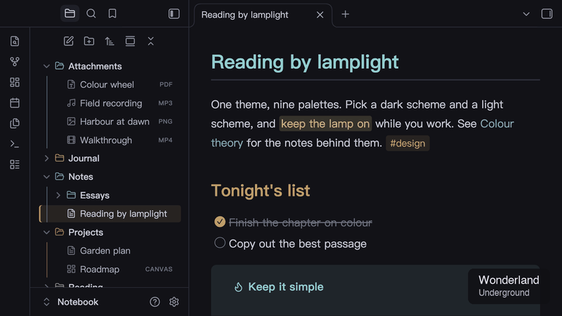
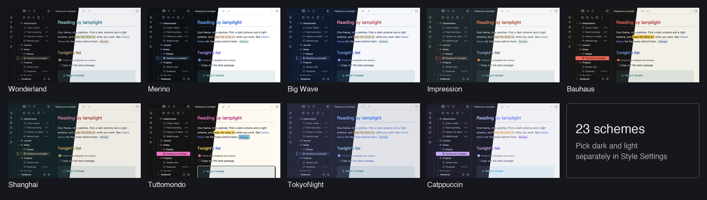

# Lamplit

[English](README.md) · 简体中文

青灯夜读（Reading by lamplight）。九套配色，用于 [Obsidian](https://obsidian.md) 和 [Typora](https://typora.io)，都由同一套源文件生成。



- **Obsidian**：只有一个主题 **Lamplit**，所有配色都是它的方案。深色和浅色模式可以在 [Style Settings](https://github.com/mgmeyers/obsidian-style-settings) 里分别选择。
- **Typora**：每个配色变体是一个主题文件，命名为 `lamplit-<配色>-<变体>.css`。

## 配色

| 配色 | 深色 | 浅色 | 灵感来源 |
|------|------|------|----------|
| [Wonderland](typora/wonderland/README.zh-CN.md) | Underground、Office District | Lab | 原创，灵感来自村上春树《世界尽头与冷酷仙境》 |
| [Merino](typora/merino/README.zh-CN.md) | Dark | Light | Merino Light / Dark 终端配色（GitHub Primer 色彩） |
| [Big Wave](typora/big-wave/README.zh-CN.md) | Pipeline | Spray | 山下达郎专辑《Big Wave》（1984）的封面 |
| [Impression](typora/impression/README.zh-CN.md) | Havre | Brume | 莫奈《印象·日出》（1872） |
| [Bauhaus](typora/bauhaus/README.zh-CN.md) | Weimar | Dessau | 包豪斯：三原色、平涂色块、直角 |
| [Shanghai](typora/shanghai/README.zh-CN.md) | Bund | Wukang | 黄浦江两岸的上海：外滩的金、东岸的玻璃青、梧桐和红瓦 |
| [Tuttomondo](typora/tuttomondo/README.zh-CN.md) | Subway | Pisa | 致敬 1989 年比萨的壁画《Tuttomondo》：粗黑轮廓里的平涂亮色，加上硬阴影 |
| [TokyoNight](typora/tokyonight/README.zh-CN.md) | Storm、Night、Moon | Day | [tokyonight.nvim](https://github.com/folke/tokyonight.nvim)（官方配色） |
| [Catppuccin](typora/catppuccin/README.zh-CN.md) | Mocha、Macchiato、Frappé | Latte | [Catppuccin](https://catppuccin.com)（官方配色） |



各平台的详细说明见 [Lamplit for Obsidian](obsidian/lamplit/README.zh-CN.md)，以及上表中各配色的 Typora 说明。

## 安装

这些主题还没有上架 Obsidian 和 Typora 的主题库。下面有三种安装方式，都不需要账号。

### 方式一：一行命令（macOS、Linux）

需要 `curl` 和 `unzip`。重新运行同样的命令即可更新。

```bash
# Obsidian：传入你的 vault 路径
curl -fsSL https://raw.githubusercontent.com/agiledolphin/themes/main/install.sh | bash -s -- obsidian /path/to/your/vault

# Typora：全部主题
curl -fsSL https://raw.githubusercontent.com/agiledolphin/themes/main/install.sh | bash -s -- typora

# Typora：只装部分配色
curl -fsSL https://raw.githubusercontent.com/agiledolphin/themes/main/install.sh | bash -s -- typora big-wave impression
```

脚本安装的是最新发布版本，只写入主题文件夹。脚本很短，可以[先读一遍](install.sh)。

### 方式二：下载发布包

从[最新发布版本](https://github.com/agiledolphin/themes/releases/latest)下载：

- **Obsidian**：把 `Lamplit-obsidian.zip` 解压到 `<你的 vault>/.obsidian/themes/`，得到 `themes/Lamplit/theme.css`。在访达里按 Cmd+Shift+. 可以显示隐藏的 `.obsidian` 文件夹。
- **Typora**：解压 `Lamplit-typora.zip`，把需要的 `.css` 文件直接复制到 Typora 的主题文件夹，不要建子文件夹：
  - **macOS**：`~/Library/Application Support/abnerworks.Typora/themes/`
  - **Windows**：`%APPDATA%\Typora\themes\`
  - **Linux**：`~/.config/Typora/themes/`

### 方式三：克隆仓库

```bash
git clone https://github.com/agiledolphin/themes.git
cd themes
./scripts/sync-obsidian.sh /path/to/your/vault
./scripts/sync-typora.sh              # 全部主题（仅 macOS）
./scripts/sync-typora.sh big-wave     # 一套配色（typora/ 下的目录名）
```

这种方式安装的是当前的 `main` 分支。更新时运行 `git pull`，再运行一次同步脚本。

### 安装之后

**Obsidian**

1. 重启 Obsidian，打开**设置 → 外观 → 主题**，选择 **Lamplit**。
2. 在第三方插件市场安装 **Style Settings**。
3. 打开**设置 → Style Settings → Lamplit**，选择 **Dark Mode Scheme**（深色方案）和 **Light Mode Scheme**（浅色方案）。

不安装 Style Settings 时，深色模式使用 Wonderland · Underground，浅色模式使用 Wonderland · Lab。

**找不到 Lamplit？** 它在**设置 → 外观 → 主题**的下拉框里，不在**管理**里；**管理**只搜索社区主题库。如果文件夹名和 `manifest.json` 里的 `name` 不一致，哪怕只差大小写，Obsidian 也会直接跳过这个主题，不提示错误。所以请确认文件夹名就是 `Lamplit`，并且 `theme.css` 和 `manifest.json` 直接放在里面。

**Typora**

重启 Typora，在**主题**菜单里选择 **Lamplit …**。每个变体都是独立的主题，所以 Typora 不会自动在深色和浅色之间切换。

## 开发

所有主题文件都是生成的，请不要手动修改 `obsidian/lamplit/theme.css`、`obsidian/lamplit/manifest.json` 和 `typora/<palette>/*.css`。

| 源文件 | 内容 |
|--------|------|
| `shared/palettes/<palette>.toml` | 一套配色的变体、颜色、颜色角色和风格开关 |
| `shared/lamplit.toml` | Lamplit 的名称、版本、默认方案和配色顺序 |
| `scripts/templates/` | 所有配色共用的 CSS |

```bash
./scripts/gen-themes.py           # 重新生成全部主题（通过 uv 运行）
./scripts/gen-themes.py --check   # 有文件过期时以状态码 1 退出
```

要新增配色，请创建 `shared/palettes/<palette>.toml`，把名称加入 `shared/lamplit.toml` 的 `schemes`，然后运行生成器。

要发布新版本，请运行 `./scripts/package-release.sh`。它会把两个压缩包生成到 `dist/`，并打印 `gh release create` 命令。

`scripts/verify-obsidian/` 用来检查 Obsidian 里的实际渲染：对比阅读视图和实时预览、检查文字对比度，并和之前的运行结果比较。约定和核验流程见 [CLAUDE.md](CLAUDE.md)，进度和当前版本见 [THEMES_PLAN.md](THEMES_PLAN.md)。

## 致谢

- 配色：[@folke](https://github.com/folke) 的 [tokyonight.nvim](https://github.com/folke/tokyonight.nvim)；Catppuccin 组织的 [Catppuccin](https://catppuccin.com)
- 设计参考：[@kepano](https://github.com/kepano) 的 [Minimal](https://github.com/kepano/obsidian-minimal)
- 图标：[Lucide](https://lucide.dev)，也是 Obsidian 自身使用的图标集

## 许可证

[MIT](LICENSE)
