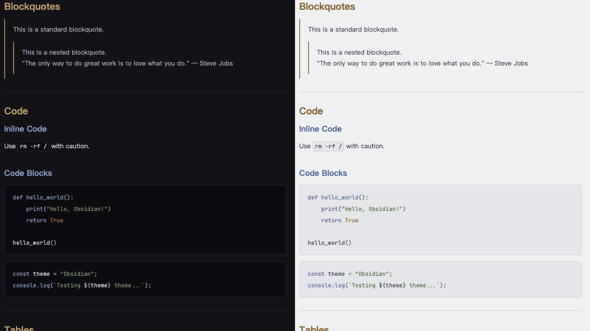

# Lamplit for Obsidian

Reading by lamplight (青灯夜读). Lamplit is one Obsidian theme that carries seven palettes as schemes — **Wonderland**, **Merino**, **Big Wave**, **Impression**, **Bauhaus**, **TokyoNight** and **Catppuccin** — so you switch palettes in [Style Settings](https://github.com/mgmeyers/obsidian-style-settings) instead of switching themes. Dark and light mode each get their own scheme, and they can come from different palettes.

---

## Schemes

| Palette | Scheme | Mode | Background | Character |
|---------|--------|------|------------|-----------|
| Wonderland | Underground | Dark | `#121218` | The INKlings' sewers — darkest, coldest (default dark) |
| Wonderland | Office District | Dark | `#1d1d1d` | Tokyo at night above ground — a shade lighter, warmer |
| Wonderland | Lab | Light | `#eef0f2` | The System's sterile laboratory — cold white (default light) |
| Merino | Dark | Dark | `#0d1117` | Near-black ground, cool light text |
| Merino | Light | Light | `#ffffff` | White ground, near-black text |
| Big Wave | Pipeline | Dark | `#0e1a30` | Inside the tube — deep navy, foam-white text |
| Big Wave | Spray | Light | `#f4f7fb` | White spray — blue-white ground, deep-navy text |
| Impression | Havre | Dark | `#1c272c` | The harbour before sunrise — slate grey-green, misty text |
| Impression | Brume | Light | `#f4f6f5` | Morning mist — airy grey-green white, slate text |
| Bauhaus | Weimar | Dark | `#161616` | Black ground, paper-white text, bright primaries |
| Bauhaus | Dessau | Light | `#f3f0e7` | Warm paper white, near-black text |
| TokyoNight | Storm | Dark | `#24283b` | Blue-grey, standard dark |
| TokyoNight | Night | Dark | `#1a1b26` | Deep, near-black |
| TokyoNight | Moon | Dark | `#222436` | Blue-purple tint |
| TokyoNight | Day | Light | `#e1e2e7` | Low-saturation light |
| Catppuccin | Mocha | Dark | `#1e1e2e` | Deep navy, the darkest flavor |
| Catppuccin | Macchiato | Dark | `#24273a` | Slightly lighter navy |
| Catppuccin | Frappé | Dark | `#303446` | Cool dark grey-blue |
| Catppuccin | Latte | Light | `#eff1f5` | Warm parchment light |

Wonderland is an original palette inspired by the "Hard-Boiled Wonderland" half of Haruki Murakami's *Hard-Boiled Wonderland and the End of the World*: restrained indigo-black grounds, cool grey-white text, and a single warm brass accent. Merino follows the Merino Light / Merino Dark terminal themes (GitHub Primer colors): neutral white and near-black grounds with crisp accents. Big Wave follows the cover of Tatsuro Yamashita's *Big Wave* (1984): ocean-navy and spray-white grounds, a coral title color for H1, cobalt links and a yellow-surfboard highlight. Impression follows Monet's *Impression, Sunrise* (1872): cool, muted grey-blue and grey-green mist with the orange sun as the only warm note; its light scheme is kept airy. Bauhaus follows the Bauhaus school: red, yellow and blue on paper white or black, solid blocks and square corners — the highlight is a solid yellow block, the file explorer and menus use solid fills, and every corner is square, Obsidian's own UI included. TokyoNight and Catppuccin follow their official palettes.

Each palette keeps its own character beyond color:

- **File explorer** — Wonderland, Merino, Big Wave, Impression and TokyoNight mark the open file with an accent tint and a left bar; Catppuccin and Bauhaus use solid fills (Catppuccin: lavender on hover, mauve for the open file; Bauhaus: blue on hover, red for the open file).
- **Context menus** — the selected item follows the same language: an accent tint, or a solid fill for Catppuccin (lavender) and Bauhaus (red).

---

## Choosing schemes (Style Settings)

1. Install **Style Settings** from the Community Plugins list.
2. Open **Settings → Style Settings → Lamplit**.
3. Pick a **Dark Mode Scheme** (12 options) and a **Light Mode Scheme** (7 options).

Without Style Settings, Lamplit uses **Wonderland · Underground** in dark mode and **Wonderland · Lab** in light mode.

---

## Features

- **Full Obsidian variable mapping** — backgrounds, text, links, code, headings, tags, callouts, checkboxes, graph, ribbon
- **Reading view and Live Preview look the same** — headings, code blocks (frame, size, font, line height), inline code, tables, blockquotes, tags, highlights and links are driven by the same variables in both views
- **Callouts** — all 13 official types with semantic colors; titles and icons take the per-type hue
- **Task list** — 7 states with custom circular checkboxes: `x`, `/`, `-`, `>`, `?`, `!`
- **Tables** — sized to their content, rounded frame (square in Bauhaus), single grid lines, 14px text
- **Search highlights** — one dedicated search color per palette (Wonderland cyan, Merino orange, Big Wave sunset orange, Impression lilac, Bauhaus orange, TokyoNight orange, Catppuccin peach), distinct from highlighted text and the selection
- **Context menus** — a darker surface than the editor; destructive items such as Delete turn red when selected
- **Chinese-first typography** — PingFang SC → Hiragino Sans GB → Noto Serif SC
- **File type icons** in the file explorer — notes, images, canvases, bases, PDFs, audio, video and other files each have their own icon
- **Hide Folder Icons** and **Hide File Icons** toggles in Style Settings
- **Color Folders** toggle in Style Settings (off by default) — each top-level folder takes the next color of an 8-color cycle from the scheme, and everything inside it inherits that color

> **Note (Color Folders):** colors follow the folder's position, not its name. A new top-level folder shifts the colors after it. In a long file list, Obsidian removes top-level folders that are scrolled out of view, so the remaining folders renumber and can change color while you scroll. A theme cannot avoid this, because it only has CSS.

> **Note (macOS):** Obsidian uses native system menus on macOS by default, and themes cannot style those. To see the themed context menus, turn off **Settings → Interface → Advanced → Native menus**.

---

## Installation

Once Lamplit is listed in the Obsidian community directory, install it from **Settings → Appearance → Themes → Manage**. To install it by hand:

1. Copy `theme.css` and `manifest.json` to `<your-vault>/.obsidian/themes/Lamplit/`. The folder must be named exactly `Lamplit`: Obsidian silently skips a theme whose folder name differs from the manifest's `name`, even by case
2. Open **Settings → Appearance → Themes** and select **Lamplit**

---

## Credits

- Palettes: [tokyonight.nvim](https://github.com/folke/tokyonight.nvim) by [@folke](https://github.com/folke); [Catppuccin](https://catppuccin.com) by the Catppuccin org; Merino after the Merino Light / Dark terminal themes (GitHub Primer colors); Big Wave after the cover of Tatsuro Yamashita's *Big Wave*; Impression after Claude Monet's *Impression, Sunrise*; Bauhaus after the Bauhaus school; Wonderland is original
- Design reference: [Minimal](https://github.com/kepano/obsidian-minimal) by [@kepano](https://github.com/kepano)
- Icons: [Lucide](https://lucide.dev), the set Obsidian itself uses

---

## Source

The theme files in `agiledolphin/lamplit` are generated. Their sources, and the same palettes for Typora, are in [agiledolphin/themes](https://github.com/agiledolphin/themes).

---

## License

MIT
