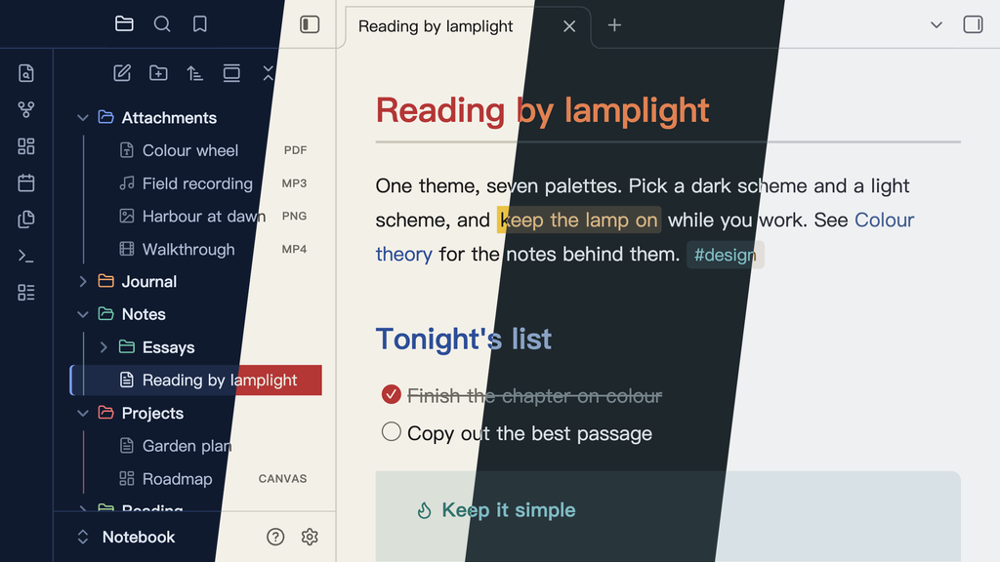
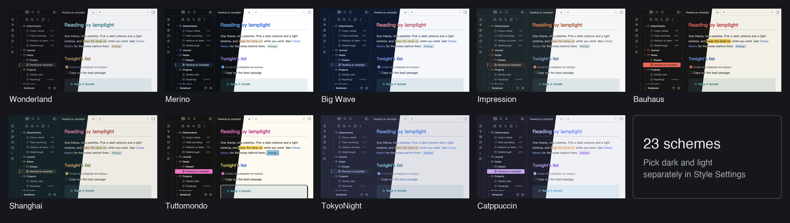

# Lamplit

[English](README.md) · 简体中文

青灯夜读。**一个主题，七套配色。** 深色模式和浅色模式可以分别选择方案，也可以来自不同的配色。

## 开始使用

1. 在**设置 → 外观 → 主题 → 管理**里安装 **Lamplit**。
2. 在第三方插件市场安装 **Style Settings**。
3. 打开**设置 → Style Settings → Lamplit**，选择 **Dark Mode Scheme**（深色方案）和 **Light Mode Scheme**（浅色方案）。

不安装 Style Settings 就只有 Wonderland，无法切换配色。

## 配色

| 配色 | 深色 | 浅色 | 灵感来源 |
|------|------|------|----------|
| **Wonderland** | Underground、Office District | Lab | 村上春树《世界尽头与冷酷仙境》：墨黑底和唯一的黄铜点缀（原创） |
| **Merino** | Dark | Light | Merino 终端配色：中性底色，GitHub Primer 色彩 |
| **Big Wave** | Pipeline | Spray | 山下达郎《Big Wave》：海军蓝、浪花白和珊瑚粉标题 |
| **Impression** | Havre | Brume | 莫奈《印象·日出》：灰绿晨雾和一轮橙红的太阳 |
| **Bauhaus** | Weimar | Dessau | 包豪斯：三原色、平涂色块、直角 |
| **TokyoNight** | Storm、Night、Moon | Day | 官方 [tokyonight.nvim](https://github.com/folke/tokyonight.nvim) 配色 |
| **Catppuccin** | Mocha、Macchiato、Frappé | Latte | 官方 [Catppuccin](https://catppuccin.com) 配色 |

## 特性

- **阅读视图和实时预览外观一致**：标题、代码、表格、引用、标签、高亮和链接都相同
- **文件类型图标**：文件列表里的笔记、图片、白板、数据库、PDF、音频和视频各有图标
- **Mermaid 图使用方案的配色**，深浅模式都适配：流程图、时序图、饼图、类图、状态图、甘特图、ER 图、Git 图和思维导图
- **Callout**：全部 13 种官方类型，各有自己的颜色
- **任务状态**：`x`、`/`、`-`、`>`、`?`、`!`，都是圆形复选框
- **搜索高亮**有独立的颜色，和高亮文字、选区都不同
- **中文优先的排版**：PingFang SC → Hiragino Sans GB → Noto Serif SC

Style Settings 页面还有四个开关：**Hide Folder Icons**（隐藏文件夹图标）、**Hide File Icons**（隐藏文件图标）、**Color Folders**（目录上色）和 **Use Default Mermaid Colors**（使用 Obsidian 默认的 Mermaid 颜色）。

## 须知

- **上面的主图开着 Color Folders。** 它默认关闭，打开后各方案看起来会有些不同。
- **Color Folders 按位置上色，不按名称。** 每个顶层目录按顺序取方案里 8 种颜色中的下一种，所以新增顶层目录会让后面的目录变色。列表较长时，Obsidian 会移除滚出屏幕的目录，剩下的目录序号改变，滚动时颜色可能变化。主题只有 CSS，无法避免。
- **macOS 右键菜单。** Obsidian 默认使用系统原生菜单，主题无法设置样式。要看到主题样式的菜单，请在设置里关闭**原生菜单**。

## 手动安装

1. 从[最新发布版本](https://github.com/agiledolphin/lamplit/releases/latest)下载 `theme.css` 和 `manifest.json`。
2. 放到 `<你的 vault>/.obsidian/themes/Lamplit/`。文件夹名必须就是 `Lamplit`：如果文件夹名和 manifest 的 `name` 不一致，哪怕只差大小写，Obsidian 也会直接跳过，不提示错误。
3. 重启 Obsidian，在**设置 → 外观 → 主题**里选择 **Lamplit**。

## 源码

`agiledolphin/lamplit` 里的文件都是生成的。源文件和 Typora 版本的同一组配色在 [agiledolphin/themes](https://github.com/agiledolphin/themes)，问题也请到那里反馈。

## 致谢

- 配色：[@folke](https://github.com/folke) 的 [tokyonight.nvim](https://github.com/folke/tokyonight.nvim)；Catppuccin 组织的 [Catppuccin](https://catppuccin.com)；Merino 来自 Merino Light / Dark 终端配色（GitHub Primer 色彩）；Big Wave 来自山下达郎《Big Wave》的封面；Impression 来自莫奈《印象·日出》；Bauhaus 来自包豪斯；Wonderland 为原创
- 设计参考：[@kepano](https://github.com/kepano) 的 [Minimal](https://github.com/kepano/obsidian-minimal)
- 图标：[Lucide](https://lucide.dev)，也是 Obsidian 自身使用的图标集

## 许可证

MIT
