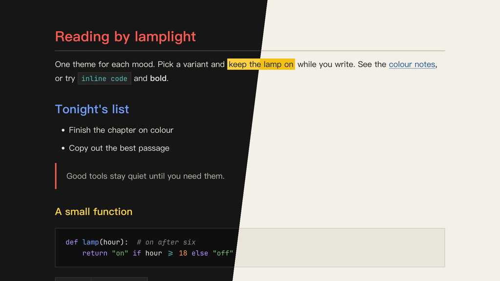

# Lamplit Bauhaus（Typora 主题）

[English](README.md) · 简体中文

来自包豪斯（1919–1933）：暖纸白或黑底上的三原色，平涂色块，直角。正文只用红、黄、蓝和黑白灰；伊顿色环（包豪斯基础课的内容）上的二次色只用在代码里。

提供两个变体，各是一个独立的 CSS 文件，以学校最早的两个所在地命名。颜色与 Obsidian 主题 Lamplit 的 Bauhaus 方案一致。

---

## 截图



---

## 变体

| 文件 | 模式 | 背景 | 文字 |
|------|------|------|------|
| `lamplit-bauhaus-weimar.css` | 深色 | `#161616` | `#ece8de` |
| `lamplit-bauhaus-dessau.css` | 浅色 | `#f3f0e7` | `#1c1c1c` |

## 颜色分工

| 角色 | Weimar | Dessau | 用途 |
|------|--------|--------|------|
| 红 Red | `#ff5a4e` | `#c4262e` | H1，强调色：光标、引用竖线、任务复选框、当前文件 |
| 蓝 Blue | `#6f9dff` | `#1f4f9c` | 链接、H2、标签、表头 |
| 信号黄 Signal yellow | `#ffd23f` | `#f2c014` | 实心 `==高亮==` 色块 |
| 黄 Yellow | `#ffd23f` | `#876700` | Weimar 的 H3；代码属性和警告（Dessau 里压暗以便阅读） |
| 橙 Orange | `#ff9a3c` | `#ad5106` | 搜索命中、数字（代码） |
| 绿 Green | `#6cc070` | `#2e7d32` | 字符串（代码） |
| 紫 Violet | `#b48cff` | `#6a3fa0` | 关键字（代码） |
| 青绿 Teal | `#4fc1b8` | `#00756e` | 行内代码 |

文字点缀色对比度都在 4.6:1 以上，相近颜色之间的色差 ΔE ≥ 26。

---

## 特性

- **正文只用原色**：红、黄、蓝和黑白灰；橙、绿、紫、青绿只出现在代码里
- **实色高亮**：`==高亮==` 是实心黄块加深色字，不是淡色底
- **直角**：代码块、表格、行内代码、高亮、引用和 front matter 都没有圆角
- **标题层级**：H1 红 → H2 蓝 → H3 黄（Weimar）或加粗近黑（Dessau）→ 正文色 → 注释色
- **中文优先的排版**：PingFang SC → Hiragino Sans GB → Noto Serif SC，行高舒适
- **代码块**：同时支持 highlight.js 和 CodeMirror 的语法高亮，颜色分工和 Obsidian 版一致
- **透明引用块**：红色竖线，嵌套引用用蓝色
- **直角网格表格**：蓝色表头文字和下划线，行悬停淡色，没有斑马纹
- **元素覆盖完整**：任务列表、脚注、公式、Mermaid 图、YAML front matter、目录
- **打印 / PDF 导出**：优化了版式和分页

---

## 安装

### 一行命令（macOS、Linux）

不需要克隆仓库，重新运行即可更新。

```bash
curl -fsSL https://raw.githubusercontent.com/agiledolphin/themes/main/install.sh | bash -s -- typora bauhaus
```

### 同步脚本

如果你已经克隆了仓库：

```bash
./scripts/sync-typora.sh bauhaus
```

### 手动安装

1. 找到 Typora 的主题文件夹：
   - **macOS**：`~/Library/Application Support/abnerworks.Typora/themes/`
   - **Windows**：`%APPDATA%\Typora\themes\`
   - **Linux**：`~/.config/Typora/themes/`
2. 把需要的文件复制到这个文件夹：
   - `lamplit-bauhaus-weimar.css`
   - `lamplit-bauhaus-dessau.css`
3. 打开 **Typora → 偏好设置 → 外观**，选择对应的主题

---

## 许可证

MIT
