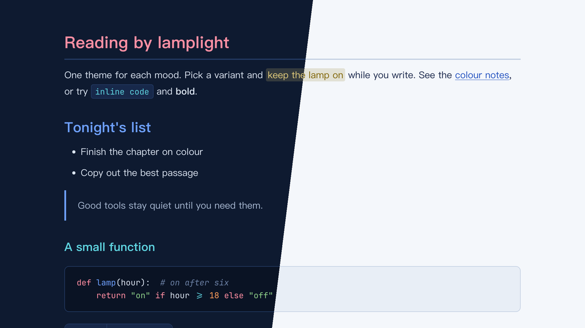

# Lamplit Big Wave（Typora 主题）

[English](README.md) · 简体中文

夏日海洋风格，来自山下达郎专辑《Big Wave》（1984）的封面：浪管内侧的深海军蓝、白色浪花、钴蓝的天空、标题的珊瑚粉手写字和黄色冲浪板。封面上只有蓝、白、珊瑚粉和黄，棕榈绿、晚霞橙和红取自同一个 80 年代 City Pop 的夏天。

提供两个变体，各是一个独立的 CSS 文件。颜色与 Obsidian 主题 Lamplit 的 Big Wave 方案一致。

---

## 截图



---

## 变体

| 文件 | 模式 | 背景 | 文字 |
|------|------|------|------|
| `lamplit-big-wave-pipeline.css` | 深色 | `#0e1a30` | `#dbe5f2` |
| `lamplit-big-wave-spray.css` | 浅色 | `#f4f7fb` | `#18264a` |

## 颜色分工

| 角色 | Pipeline | Spray | 用途 |
|------|----------|-------|------|
| 珊瑚粉 Coral | `#ff8fa3` | `#bd4762` | 标题色：H1、表头、嵌套引用、代码关键字 |
| 钴蓝 Cobalt | `#6ea0ff` | `#1f4fbf` | 强调色：链接、H2、引用竖线、任务复选框、侧边栏当前文件 |
| 水青 Aqua | `#5fd4e0` | `#007283` | H3、行内代码、标签 |
| 冲浪板黄 Board | `#e6cf7e` | `#7e6200` | `==高亮==` 文字、H5 |
| 晚霞橙 Sunset | `#ff9f5a` | `#b8500f` | 搜索命中、数字 |
| 棕榈绿 Palm | `#8fd18a` | `#2f7a2a` | 字符串、H4 |
| 红 Red | `#ff6b6b` | `#c0303a` | 错误、删除行 |

所有点缀色对比度都在 4.6:1 以上，相近颜色之间的色差 ΔE ≥ 21。Spray 里的冲浪板黄为了在白底上看得清，压成了芥末黄褐色。

---

## 特性

- **海洋底色**：深色模式深海军蓝，浅色模式蓝白浪花
- **标题层级**：H1–H6 依次为珊瑚粉 → 钴蓝 → 水青 → 棕榈绿 → 冲浪板黄 → 注释色
- **中文优先的排版**：PingFang SC → Hiragino Sans GB → Noto Serif SC，行高舒适
- **代码块**：同时支持 highlight.js 和 CodeMirror 的语法高亮，颜色分工和 Obsidian 版一致
- **透明引用块**：钴蓝竖线，嵌套引用用珊瑚粉
- **圆角网格表格**：珊瑚粉表头文字和下划线，行悬停淡色，没有斑马纹
- **元素覆盖完整**：任务列表、脚注、公式、Mermaid 图、YAML front matter、目录
- **打印 / PDF 导出**：优化了版式和分页

---

## 安装

### 一行命令（macOS、Linux）

不需要克隆仓库，重新运行即可更新。

```bash
curl -fsSL https://raw.githubusercontent.com/agiledolphin/themes/main/install.sh | bash -s -- typora big-wave
```

### 同步脚本

如果你已经克隆了仓库：

```bash
./scripts/sync-typora.sh big-wave
```

### 手动安装

1. 找到 Typora 的主题文件夹：
   - **macOS**：`~/Library/Application Support/abnerworks.Typora/themes/`
   - **Windows**：`%APPDATA%\Typora\themes\`
   - **Linux**：`~/.config/Typora/themes/`
2. 把需要的文件复制到这个文件夹：
   - `lamplit-big-wave-pipeline.css`
   - `lamplit-big-wave-spray.css`
3. 打开 **Typora → 偏好设置 → 外观**，选择对应的主题

---

## 许可证

MIT
