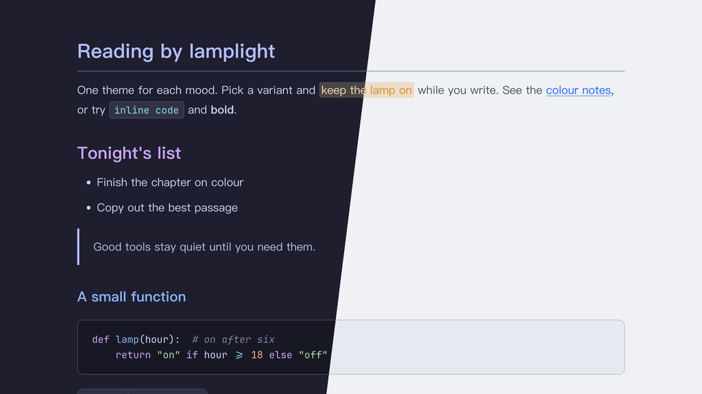

# Lamplit Catppuccin（Typora 主题）

[English](README.md) · 简体中文

基于 [Catppuccin](https://catppuccin.com) 配色。提供四种风味，各是一个独立的 CSS 文件，每个都有完整的配色。

---

## 截图



---

## 变体

| 文件 | 模式 | 背景 | 特点 |
|------|------|------|------|
| `lamplit-catppuccin-mocha.css` | 深色 | `#1e1e2e` | 深海军蓝，最深的风味 |
| `lamplit-catppuccin-macchiato.css` | 深色 | `#24273a` | 略浅的海军蓝 |
| `lamplit-catppuccin-frappe.css` | 深色 | `#303446` | 冷调深灰蓝 |
| `lamplit-catppuccin-latte.css` | 浅色 | `#eff1f5` | 温暖的羊皮纸浅色 |

---

## 特性

- **四种独立风味**：各有完整配色，不是近似调整出来的
- **标题层级**：H1–H6 用不同的点缀色（薰衣草 → 蓝 → 青 → 青绿 → 绿 → 注释色）
- **中文优先的排版**：PingFang SC → Hiragino Sans GB → Noto Serif SC，行高舒适
- **代码块**：同时支持 highlight.js 和 CodeMirror 的语法高亮
- **元素覆盖完整**：引用、表格、任务列表、脚注、公式、Mermaid 图、YAML front matter、目录
- **侧边栏细节**：文件面板的当前项高亮和悬停色，大纲面板的当前项（加粗）和悬停（背景 + 下划线）状态
- **打印 / PDF 导出**：优化了版式和分页

---

## 安装

### 一行命令（macOS、Linux）

不需要克隆仓库，重新运行即可更新。

```bash
curl -fsSL https://raw.githubusercontent.com/agiledolphin/themes/main/install.sh | bash -s -- typora catppuccin
```

### 同步脚本

如果你已经克隆了仓库：

```bash
./scripts/sync-typora.sh catppuccin
```

### 手动安装

1. 找到 Typora 的主题文件夹：
   - **macOS**：`~/Library/Application Support/abnerworks.Typora/themes/`
   - **Windows**：`%APPDATA%\Typora\themes\`
   - **Linux**：`~/.config/Typora/themes/`
2. 把需要的文件复制到这个文件夹：
   - `lamplit-catppuccin-mocha.css`
   - `lamplit-catppuccin-macchiato.css`
   - `lamplit-catppuccin-frappe.css`
   - `lamplit-catppuccin-latte.css`
3. 打开 **Typora → 偏好设置 → 外观**，选择对应的主题

---

## 字体建议

- **正文**：PingFang SC / Hiragino Sans GB / Noto Serif SC / Georgia
- **等宽**：[JetBrains Mono](https://www.jetbrains.com/lp/mono/) 或 [Fira Code](https://github.com/tonsky/FiraCode)

---

## 致谢

- 配色：Catppuccin 组织的 [Catppuccin](https://catppuccin.com)

---

## 许可证

MIT
