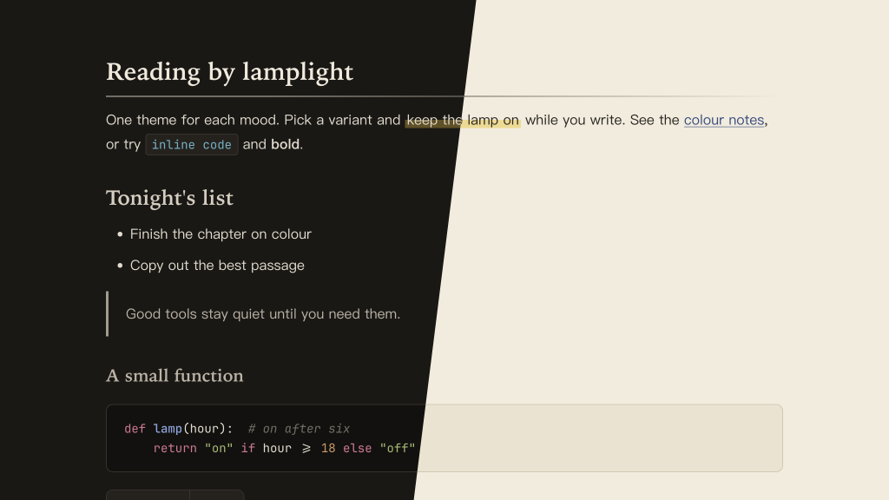

# Lamplit Fuchun for Typora

English · [简体中文](README.zh-CN.md)

A Typora theme after Chinese ink painting, and after one scroll in particular: Huang Gongwang's *Dwelling in the Fuchun Mountains* (1350). Ink carries the page. Headings step through the five shades of ink (墨分五色: 焦 浓 重 淡 清) instead of colors, a single cinnabar red plays the part of the painter's seal, and the painter's mineral and plant pigments appear only in code. Headings are set in Kaiti, rules and highlights are drawn like brush strokes.

The scroll was later split by fire into two parts: *Remaining Mountain* (剩山图), now in Hangzhou, and the *Master Wuyong Scroll* (无用师卷), now in Taipei. The two variants are named after them, and provided as separate CSS files. Colors match the Fuchun scheme in the Obsidian theme Lamplit.

---

## Screenshots



---

## Variants

| File | Mode | Background | Text |
|------|------|------------|------|
| `lamplit-fuchun-shengshan.css` | Dark  | `#1a1815` | `#e3dccd` |
| `lamplit-fuchun-wuyong.css`    | Light | `#f3ecdc` | `#2a2621` |

Shengshan reads like a rubbing: paper-white strokes on warm ink black. Wuyong is ink on aged xuan paper.

## Color roles

| Role | Shengshan | Wuyong | Used for |
|------|-----------|--------|----------|
| 焦 Scorched ink | `#f1eadb` | `#1b1916` | H1 |
| 浓 Thick ink    | `#d6cebf` | `#36322c` | H2, table header |
| 重 Heavy ink    | `#bcb4a5` | `#4b463e` | H3 |
| 淡 Pale ink     | `#a29b8e` | `#5f594f` | H4, the blockquote rule |
| 清 Clear ink    | `#8e877b` | `#6e675c` | H5 |
| Comment ink     | `#736d63` | `#857d70` | H6, comments, the brush-stroke rules |
| 朱砂 Cinnabar   | `#e3664f` | `#b2361f` | the accent: task checkboxes, the active file in the sidebar, errors |
| 花青 Indigo     | `#86a3dc` | `#2f4b80` | links, code functions |
| 石青 Azurite    | `#63b2c6` | `#1b6478` | inline code, code types |
| 藤黄 Gamboge wash | `#62501e` | `#f0d98a` | the brush-stroke `==highlight==` |

Code also uses 石绿 malachite, 汁绿 sap green, 赭石 ochre and 胭脂 carmine. H1–H5 read at 4.7:1 or better, H6 at 3.4:1, and every pigment at 5.1:1 or better; look-alike pigments stay at a color difference of ΔE ≥ 21.

---

## Features

- **Five shades of ink** — headings go from scorched to clear ink, with no color
- **Kaiti headings** — Chinese in Kaiti, Latin in a book serif; where Kaiti is missing, Songti
- **Brush strokes** — the H1 underline and horizontal rules fade out like a stroke of ink, and `==highlights==` are a gamboge wash behind the lower half of the text
- **A single seal** — cinnabar only where the eye needs a mark; blockquotes have a pale ink rule
- **Chinese-first typography** — PingFang SC → Hiragino Sans GB → Noto Serif SC for body text
- **Code blocks** — syntax highlighting via both highlight.js and CodeMirror classes, same color roles as the Obsidian version
- **Full element coverage** — task lists, footnotes, math, Mermaid diagrams, YAML front matter, TOC
- **Print / PDF export** — optimized layout with page-break hints

In Obsidian, tags are also drawn as seals and checked tasks as small square seals. Typora has no tags, and keeps its own checkboxes, in cinnabar.

---

## Installation

### One command (macOS, Linux)

No clone needed. Run it again to update.

```bash
curl -fsSL https://raw.githubusercontent.com/agiledolphin/themes/main/install.sh | bash -s -- typora fuchun
```

### Automatic (sync script)

```bash
./scripts/sync-typora.sh fuchun
```

### Manual

1. Locate your Typora themes directory:
   - **macOS**: `~/Library/Application Support/abnerworks.Typora/themes/`
   - **Windows**: `%APPDATA%\Typora\themes\`
   - **Linux**: `~/.config/Typora/themes/`
2. Copy one or both CSS files into that directory
3. Open **Typora → Preferences → Appearance** and select the variant

---

## License

MIT
