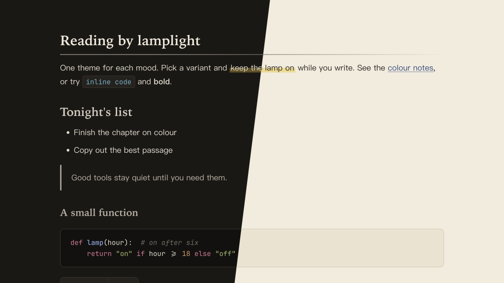

# Lamplit Fuchun（Typora 主题）

[English](README.md) · 简体中文

来自中国水墨画，具体来说是黄公望的《富春山居图》（1350）。整页以墨为主：标题不用彩色，而是按“墨分五色”的焦、浓、重、淡、清逐级变淡；一点朱砂充当画上的印章；国画的矿物和植物颜料只用在代码里。标题用楷体，分隔线和高亮像毛笔的笔触。

这幅画后来被火烧成两段：前段《剩山图》藏在杭州的浙江博物馆，后段《无用师卷》藏在台北故宫。两个变体以它们命名，各是一个独立的 CSS 文件。颜色与 Obsidian 主题 Lamplit 的 Fuchun 方案一致。

---

## 截图



---

## 变体

| 文件 | 模式 | 背景 | 文字 |
|------|------|------|------|
| `lamplit-fuchun-shengshan.css` | 深色 | `#1a1815` | `#e3dccd` |
| `lamplit-fuchun-wuyong.css` | 浅色 | `#f3ecdc` | `#2a2621` |

Shengshan 像一张拓片：暖墨黑底上的纸白笔画。Wuyong 是仿古宣纸上的墨。

## 颜色分工

| 角色 | Shengshan | Wuyong | 用途 |
|------|-----------|--------|------|
| 焦墨 | `#f1eadb` | `#1b1916` | H1 |
| 浓墨 | `#d6cebf` | `#36322c` | H2、表头 |
| 重墨 | `#bcb4a5` | `#4b463e` | H3 |
| 淡墨 | `#a29b8e` | `#5f594f` | H4、引用竖线 |
| 清墨 | `#8e877b` | `#6e675c` | H5 |
| 注释墨色 | `#736d63` | `#857d70` | H6、注释、笔触线条 |
| 朱砂 | `#e3664f` | `#b2361f` | 强调色：任务复选框、侧边栏当前文件、错误 |
| 花青 | `#86a3dc` | `#2f4b80` | 链接、代码函数 |
| 石青 | `#63b2c6` | `#1b6478` | 行内代码、代码类型 |
| 藤黄淡彩 | `#62501e` | `#f0d98a` | 笔刷式 `==高亮==` |

代码里还用到石绿、汁绿、赭石和胭脂。H1–H5 的对比度都在 4.7:1 以上，H6 为 3.4:1，所有颜料色都在 5.1:1 以上；相近颜料之间的色差 ΔE ≥ 21。

---

## 特性

- **墨分五色**：标题从焦墨到清墨逐级变淡，不用彩色
- **楷体标题**：中文用楷体，英文用书卷衬线体；没有楷体时退回宋体
- **笔触**：H1 下划线和分隔线像一笔淡墨渐渐变淡，`==高亮==` 是只铺在文字下半截的藤黄淡彩
- **一点朱砂**：朱砂只出现在需要指引视线的地方，引用竖线用淡墨
- **中文优先的排版**：正文用 PingFang SC → Hiragino Sans GB → Noto Serif SC
- **代码块**：同时支持 highlight.js 和 CodeMirror 的语法高亮，颜色分工和 Obsidian 版一致
- **元素覆盖完整**：任务列表、脚注、公式、Mermaid 图、YAML front matter、目录
- **打印 / PDF 导出**：优化了版式和分页

在 Obsidian 里，标签还会画成印章，勾选的任务是朱砂小方印。Typora 没有标签，复选框保留原生样式，颜色为朱砂。

---

## 安装

### 一行命令（macOS、Linux）

不需要克隆仓库，重新运行即可更新。

```bash
curl -fsSL https://raw.githubusercontent.com/agiledolphin/themes/main/install.sh | bash -s -- typora fuchun
```

### 同步脚本

如果你已经克隆了仓库：

```bash
./scripts/sync-typora.sh fuchun
```

### 手动安装

1. 找到 Typora 的主题文件夹：
   - **macOS**：`~/Library/Application Support/abnerworks.Typora/themes/`
   - **Windows**：`%APPDATA%\Typora\themes\`
   - **Linux**：`~/.config/Typora/themes/`
2. 把需要的文件复制到这个文件夹：
   - `lamplit-fuchun-shengshan.css`
   - `lamplit-fuchun-wuyong.css`
3. 打开 **Typora → 偏好设置 → 外观**，选择对应的主题

---

## 许可证

MIT
