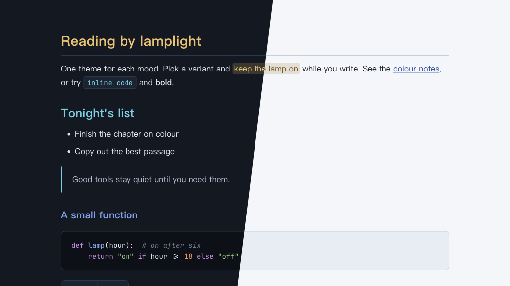

# Lamplit Himalaya for Typora

English · [简体中文](README.zh-CN.md)

A high-mountain Typora theme after the Himalaya and Nicholas Roerich's mountain canvases: thin-air slate night, twilight violet-plum moraine rock, sunlit alpine snowfields, summit gold for H1, and glacier cyan for the accent.

Three variants are provided as separate CSS files. Colors match the Himalaya scheme in the Obsidian theme Lamplit.

---

## Screenshots



---

## Variants

| File | Mode | Background | Character |
|------|------|------------|-----------|
| `lamplit-himalaya-everest.css` | Dark  | `#121822` | 8,848m stratosphere night — cold shale-slate black, crystalline snow text |
| `lamplit-himalaya-moraine.css` | Dark  | `#261d24` | Twilight moraine — violet-plum rock ground, after Roerich's dusk peaks |
| `lamplit-himalaya-snowline.css` | Light | `#f3f6f9` | Sunlit snowfield — crisp glacial white under a thin sapphire sky |

## Color roles

| Role | Everest | Moraine | Snowline | Used for |
|------|---------|---------|----------|----------|
| Summit | `#f2c166` | `#f5c872` | `#7d5700` | H1, `==highlighted==` text, warnings |
| Glacier | `#5ad0e6` | `#66d6ea` | `#0b697d` | accent, H2, table header, blockquote rule, inline code |
| Lapis | `#7ca4f2` | `#8aadf7` | `#2452a6` | links, H3, functions |
| Turquoise | `#4cc4a4` | `#58ccad` | `#136e57` | H4, tags |
| Tundra | `#92cc7a` | `#9cd282` | `#366e28` | strings |
| Ochre | `#f09456` | `#f49d62` | `#a64c0c` | search hits, numbers |
| Crimson | `#ee6868` | `#f27476` | `#b82c36` | errors, deleted lines |
| Rhododendron | `#cc8ae6` | `#d898ee` | `#7c3b96` | H5, code keywords, nested quotes |

Every accent reads at 5.29:1 or better against its background, and look-alike colors stay at a color difference of ΔE ≥ 24.

---

## Features

- **Two dark rocks, one snowfield** — cold slate-black night (`Everest`), twilight violet-plum moraine (`Moraine`), and crisp glacial white (`Snowline`)
- **Summit gold & glacier ice** — alpenglow gold crowns H1; glacier cyan leads the accent, H2, table headers and inline code
- **Heading hierarchy** — H1–H6 in summit gold → glacier cyan → lapis → turquoise → rhododendron → comment
- **Chinese-first typography** — PingFang SC → Hiragino Sans GB → Noto Serif SC, comfortable line height
- **Code blocks** — syntax highlighting via both highlight.js and CodeMirror classes, same color roles as the Obsidian version
- **Transparent blockquotes** with a glacier rule (rhododendron for nested quotes)
- **Rounded grid tables** — glacier header text and underline, row hover tint, no zebra striping
- **Full element coverage** — task lists, footnotes, math, Mermaid diagrams, YAML front matter, TOC
- **Print / PDF export** — optimized layout with page-break hints

---

## Installation

### One command (macOS, Linux)

No clone needed. Run it again to update.

```bash
curl -fsSL https://raw.githubusercontent.com/agiledolphin/themes/main/install.sh | bash -s -- typora himalaya
```

### Automatic (sync script)

```bash
./scripts/sync-typora.sh himalaya
```

### Manual

1. Locate your Typora themes directory:
   - **macOS**: `~/Library/Application Support/abnerworks.Typora/themes/`
   - **Windows**: `%APPDATA%\Typora\themes\`
   - **Linux**: `~/.config/Typora/themes/`
2. Copy the `.css` files you want into that directory
3. Open **Typora → Preferences → Appearance** and select the variant

---

## License

MIT
