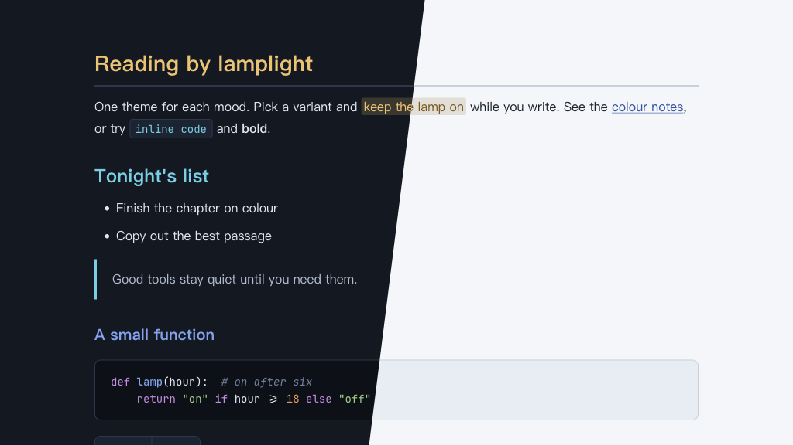

# Lamplit Himalaya（Typora 主题）

[English](README.md) · 简体中文

高海拔雪域风格的主题，致敬喜马拉雅与罗里奇笔下的山岳画：稀薄大气层的冷峻夜空、暮色中的紫褐冰碛岩、晴空雪原，日照金山作 H1，冰川松石青作主强调色。

提供三个变体，各是一个独立的 CSS 文件。颜色与 Obsidian 主题 Lamplit 的 Himalaya 方案一致。

---

## 截图



---

## 变体

| 文件 | 模式 | 背景 | 性格 |
|------|------|------|------|
| `lamplit-himalaya-everest.css` | 深色 | `#121822` | 8848 米极夜页岩：冷峻页岩黑底、冰雪白文字 |
| `lamplit-himalaya-moraine.css` | 深色 | `#261d24` | 暮色冰碛岩：带紫褐的山岩暮色底，致敬罗里奇的黄昏雪峰 |
| `lamplit-himalaya-snowline.css` | 浅色 | `#f3f6f9` | 晴空雪线：澄澈雪原白底、深玄武岩文字 |

## 颜色分工

| 角色 | Everest | Moraine | Snowline | 用途 |
|------|---------|---------|----------|------|
| 日照金山 Summit | `#f2c166` | `#f5c872` | `#7d5700` | H1、`==高亮==` 文字、警告 |
| 冰川青 Glacier | `#5ad0e6` | `#66d6ea` | `#0b697d` | 强调色、H2、表头、引用竖线、行内代码 |
| 青金石 Lapis | `#7ca4f2` | `#8aadf7` | `#2452a6` | 链接、H3、函数 |
| 松石绿 Turquoise | `#4cc4a4` | `#58ccad` | `#136e57` | H4、标签 |
| 苔原绿 Tundra | `#92cc7a` | `#9cd282` | `#366e28` | 字符串 |
| 岩赭 Ochre | `#f09456` | `#f49d62` | `#a64c0c` | 搜索命中、数字 |
| 风马绛红 Crimson | `#ee6868` | `#f27476` | `#b82c36` | 错误、删除行 |
| 高山杜鹃 Rhododendron | `#cc8ae6` | `#d898ee` | `#7c3b96` | H5、代码关键字、嵌套引用 |

所有点缀色对比度都在 5.29:1 以上，相近颜色之间的色差 ΔE ≥ 24。

---

## 特性

- **两深一浅的山岳肌理**：极夜页岩（`Everest`）、暮色紫褐岩（`Moraine`）与晴空雪原（`Snowline`）
- **日照金山与冰川青**：日照金山冠于 H1，冰川青领衔强调色、H2、表头与行内代码
- **标题层级**：H1–H6 依次为日照金山 → 冰川青 → 青金石 → 松石绿 → 高山杜鹃 → 注释色
- **中文优先的排版**：PingFang SC → Hiragino Sans GB → Noto Serif SC，行高舒适
- **代码块**：同时支持 highlight.js 和 CodeMirror 的语法高亮，颜色分工和 Obsidian 版一致
- **透明引用块**：冰川青竖线，嵌套引用用高山杜鹃紫
- **圆角网格表格**：冰川青表头文字和下划线，行悬停淡色，没有斑马纹
- **元素覆盖完整**：任务列表、脚注、公式、Mermaid 图、YAML front matter、目录
- **打印 / PDF 导出**：优化了版式和分页

---

## 安装

### 一行命令（macOS、Linux）

不需要克隆仓库，重新运行即可更新。

```bash
curl -fsSL https://raw.githubusercontent.com/agiledolphin/themes/main/install.sh | bash -s -- typora himalaya
```

### 同步脚本

如果你已经克隆了仓库：

```bash
./scripts/sync-typora.sh himalaya
```

### 手动安装

1. 找到 Typora 的主题文件夹：
   - **macOS**：`~/Library/Application Support/abnerworks.Typora/themes/`
   - **Windows**：`%APPDATA%\Typora\themes\`
   - **Linux**：`~/.config/Typora/themes/`
2. 把需要的文件复制到这个文件夹：
   - `lamplit-himalaya-everest.css`
   - `lamplit-himalaya-moraine.css`
   - `lamplit-himalaya-snowline.css`
3. 打开 **Typora → 偏好设置 → 外观**，选择对应的主题

---

## 许可证

MIT
