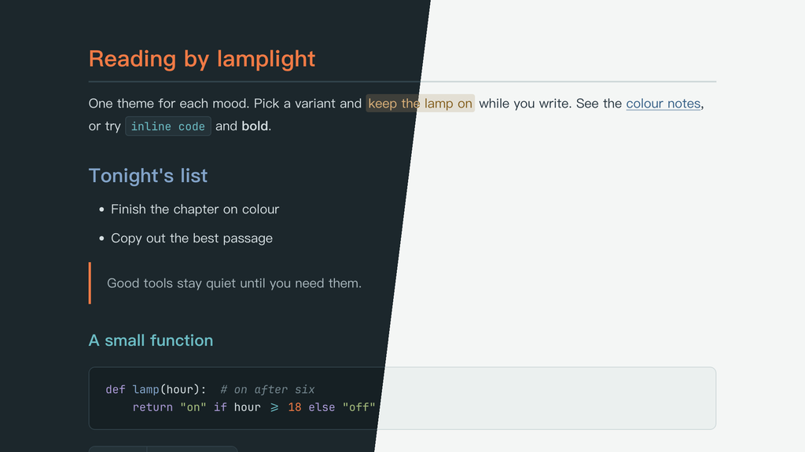

# Lamplit Impression（Typora 主题）

[English](README.md) · 简体中文

雾气蒙蒙的主题，来自莫奈《印象·日出》（1872）：清晨的勒阿弗尔港，冷灰蓝和灰绿的晨雾，深色的船影，一轮橙红的太阳和它在水面上的倒影。和画中一样，太阳是唯一鲜明的暖色，其余颜色都偏冷、偏灰。浅色版保持通透：灰绿近白的底色，各层表面只差一层雾色，正文用石板色而不是纯黑，点缀用淡淡的色调。

提供两个变体，各是一个独立的 CSS 文件。颜色与 Obsidian 主题 Lamplit 的 Impression 方案一致。

---

## 截图



---

## 变体

| 文件 | 模式 | 背景 | 文字 |
|------|------|------|------|
| `lamplit-impression-havre.css` | 深色 | `#1c272c` | `#d6dfe2` |
| `lamplit-impression-brume.css` | 浅色 | `#f4f6f5` | `#2a3842` |

## 颜色分工

| 角色 | Havre | Brume | 用途 |
|------|-------|-------|------|
| 太阳 Sun | `#f07a45` | `#b4471f` | 唯一的暖色：H1、表头、引用竖线、光标、当前文件、数字 |
| 港湾灰蓝 Harbour | `#82a3c8` | `#355f86` | 链接、H2 |
| 海水青 Water | `#6cbcc4` | `#1f6f7a` | H3、行内代码、标签 |
| 淡紫雾 Lilac | `#aa9ad6` | `#62538f` | H4、代码关键字、搜索命中、嵌套引用 |
| 赭黄 Ochre | `#dcb27a` | `#835e1d` | `==高亮==` 文字、H5 |
| 岸边灰绿 Shore | `#a6bd7e` | `#4f6b2c` | 字符串 |
| 茜红 Madder | `#e86060` | `#b2373b` | 错误、删除行 |

所有点缀色对比度都在 4.5:1 以上，相近颜色之间的色差 ΔE ≥ 20。Brume 里的太阳要作文字用，压成了深朱红，发光感比 Havre 弱一些。

---

## 特性

- **雾气底色**：深色模式石板灰绿，浅色模式通透的灰绿近白，各层表面只差一层雾色
- **唯一的暖色**：太阳（H1、表头、光标、当前文件）是唯一饱和的颜色，其余都偏冷、偏灰
- **标题层级**：H1–H6 依次为太阳 → 港湾灰蓝 → 海水青 → 淡紫雾 → 赭黄 → 注释色
- **中文优先的排版**：PingFang SC → Hiragino Sans GB → Noto Serif SC，行高舒适
- **代码块**：同时支持 highlight.js 和 CodeMirror 的语法高亮，颜色分工和 Obsidian 版一致
- **透明引用块**：太阳色竖线，嵌套引用用淡紫
- **圆角网格表格**：太阳色表头文字和下划线，行悬停淡色，没有斑马纹
- **元素覆盖完整**：任务列表、脚注、公式、Mermaid 图、YAML front matter、目录
- **打印 / PDF 导出**：优化了版式和分页

---

## 安装

### 一行命令（macOS、Linux）

不需要克隆仓库，重新运行即可更新。

```bash
curl -fsSL https://raw.githubusercontent.com/agiledolphin/themes/main/install.sh | bash -s -- typora impression
```

### 同步脚本

如果你已经克隆了仓库：

```bash
./scripts/sync-typora.sh impression
```

### 手动安装

1. 找到 Typora 的主题文件夹：
   - **macOS**：`~/Library/Application Support/abnerworks.Typora/themes/`
   - **Windows**：`%APPDATA%\Typora\themes\`
   - **Linux**：`~/.config/Typora/themes/`
2. 把需要的文件复制到这个文件夹：
   - `lamplit-impression-havre.css`
   - `lamplit-impression-brume.css`
3. 打开 **Typora → 偏好设置 → 外观**，选择对应的主题

---

## 许可证

MIT
