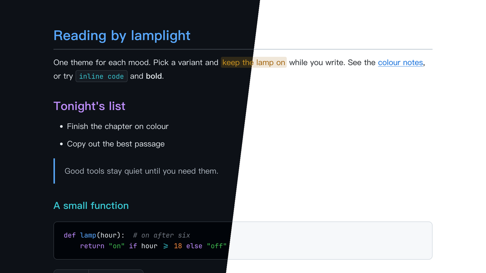

# Lamplit Merino（Typora 主题）

[English](README.md) · 简体中文

干净、中性的主题，来自 **Merino Light** 和 **Merino Dark** 终端配色：白色或近黑的底色，近黑或冷调浅色的文字，加上清爽的点缀色（GitHub Primer 色彩）。终端配色里没有青绿和橙，所以青绿取青和绿的中点，橙用 Primer 的橙。

提供两个变体，各是一个独立的 CSS 文件。颜色与 Obsidian 主题 Lamplit 的 Merino 方案一致。

---

## 截图



---

## 变体

| 文件 | 模式 | 背景 | 文字 |
|------|------|------|------|
| `lamplit-merino-light.css` | 浅色 | `#ffffff` | `#1f2328` |
| `lamplit-merino-dark.css` | 深色 | `#0d1117` | `#e6edf3` |

## 颜色分工

| 角色 | 浅色 | 深色 | 用途 |
|------|------|------|------|
| 蓝 Blue | `#0969da` | `#58a6ff` | 强调色：链接、H1、引用竖线、任务复选框、侧边栏当前文件 |
| 紫 Magenta | `#8250df` | `#bc8cff` | 第二主色：H2、表头、嵌套引用、代码关键字 |
| 青 Cyan | `#1b7c83` | `#39c5cf` | H3、行内代码 |
| 橙 Orange | `#bc4c00` | `#f0883e` | 搜索命中、数字 |
| 红 Red | `#cf222e` | `#ff7b72` | 错误、删除行、代码里的 HTML 标签 |
| 绿 Green | `#116329` | `#3fb950` | 字符串、H4 |

所有点缀色对比度都在 4.5:1 以上，相近颜色之间的色差 ΔE ≥ 16。

---

## 特性

- **中性底色**：浅色模式纯白，深色模式近黑
- **标题层级**：H1–H6 依次为蓝 → 紫 → 青 → 绿 → 黄 → 注释色
- **中文优先的排版**：PingFang SC → Hiragino Sans GB → Noto Serif SC，行高舒适
- **代码块**：同时支持 highlight.js 和 CodeMirror 的语法高亮，颜色分工和 Obsidian 版一致
- **透明引用块**：蓝色竖线，嵌套引用用紫色
- **圆角网格表格**：紫色表头文字和下划线，行悬停淡色，没有斑马纹
- **元素覆盖完整**：任务列表、脚注、公式、Mermaid 图、YAML front matter、目录
- **打印 / PDF 导出**：优化了版式和分页

---

## 安装

### 一行命令（macOS、Linux）

不需要克隆仓库，重新运行即可更新。

```bash
curl -fsSL https://raw.githubusercontent.com/agiledolphin/themes/main/install.sh | bash -s -- typora merino
```

### 同步脚本

如果你已经克隆了仓库：

```bash
./scripts/sync-typora.sh merino
```

### 手动安装

1. 找到 Typora 的主题文件夹：
   - **macOS**：`~/Library/Application Support/abnerworks.Typora/themes/`
   - **Windows**：`%APPDATA%\Typora\themes\`
   - **Linux**：`~/.config/Typora/themes/`
2. 把需要的文件复制到这个文件夹：
   - `lamplit-merino-light.css`
   - `lamplit-merino-dark.css`
3. 打开 **Typora → 偏好设置 → 外观**，选择对应的主题

---

## 许可证

MIT
