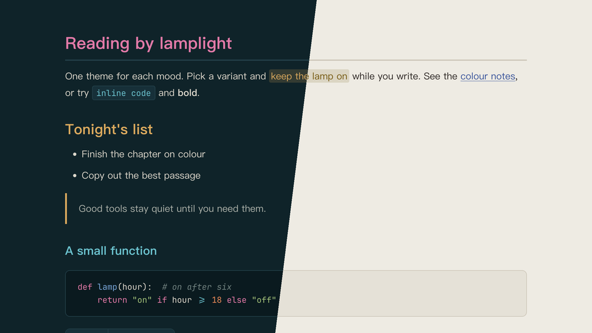

# Lamplit Shanghai for Typora

English · [简体中文](README.zh-CN.md)

A Typora theme after Shanghai on both banks of the Huangpu. The west bank brings the Bund's floodlit gold and its Art Deco copper roofs. The east bank answers with the cool glass of the Lujiazui towers and the magenta of the Oriental Pearl. Plane-tree green and brick-red tiles come from the old lanes in between.

Two variants are provided as separate CSS files: the Bund at night, and an afternoon on Wukang Road. Colors match the Shanghai scheme in the Obsidian theme Lamplit.

---

## Screenshots



---

## Variants

| File | Mode | Background | Text |
|------|------|------------|------|
| `lamplit-shanghai-bund.css`   | Dark  | `#0f2329` | `#ddd8cc` |
| `lamplit-shanghai-wukang.css` | Light | `#eeebe3` | `#2c2623` |

## Color roles

| Role | Bund | Wukang | Used for |
|------|------|--------|----------|
| Gold   | `#dcaa5e` | `#755910` | Bund's accent (H2, blockquote rule, table header, task checkboxes, active file in the sidebar); `==highlighted==` text, H5 in Wukang |
| Plane  | `#a3c27a` | `#4a6a26` | Wukang's accent (the same uses as gold in Bund); strings, H5 in Bund |
| Pearl  | `#e27aa8` | `#a2366e` | H1 in Bund, code keywords |
| Tile   | `#e66a5f` | `#b03a36` | H1 in Wukang, errors, deleted lines |
| Glass  | `#6cc3cf` | `#186a80` | inline code, tags, H3 in Bund |
| River  | `#78a6d8` | `#37529a` | links, H3 in Wukang |
| Copper | `#62b89a` | `#2b6f55` | H4, nested quotes |
| Amber  | `#e88a58` | `#a35a10` | search hits, numbers |

Every accent reads at 4.3:1 or better against its background, and look-alike colors stay at a color difference of ΔE ≥ 21. Wukang's gold is darkened so highlighted text stays readable on its gold tint.

---

## Features

- **Two banks** — warm gold leads on the river-ink ground, cool glass answers in code and tags, and the Pearl's magenta appears once, as H1
- **Heading hierarchy** — Bund: pearl → gold → glass → copper → plane → comment; Wukang: tile → plane → river → copper → gold → comment
- **Chinese-first typography** — PingFang SC → Hiragino Sans GB → Noto Serif SC, comfortable line height
- **Code blocks** — syntax highlighting via both highlight.js and CodeMirror classes, same color roles as the Obsidian version
- **Transparent blockquotes** with a gold rule in Bund and a plane-green rule in Wukang (copper for nested quotes)
- **Rounded grid tables** — accent header text and underline, row hover tint, no zebra striping
- **Full element coverage** — task lists, footnotes, math, Mermaid diagrams, YAML front matter, TOC
- **Print / PDF export** — optimized layout with page-break hints

---

## Installation

### One command (macOS, Linux)

No clone needed. Run it again to update.

```bash
curl -fsSL https://raw.githubusercontent.com/agiledolphin/themes/main/install.sh | bash -s -- typora shanghai
```

### Automatic (sync script)

```bash
./scripts/sync-typora.sh shanghai
```

### Manual

1. Locate your Typora themes directory:
   - **macOS**: `~/Library/Application Support/abnerworks.Typora/themes/`
   - **Windows**: `%APPDATA%\Typora\themes\`
   - **Linux**: `~/.config/Typora/themes/`
2. Copy one or both CSS files into that directory
3. Open **Typora → Preferences → Appearance** and select the variant

---

## License

MIT
