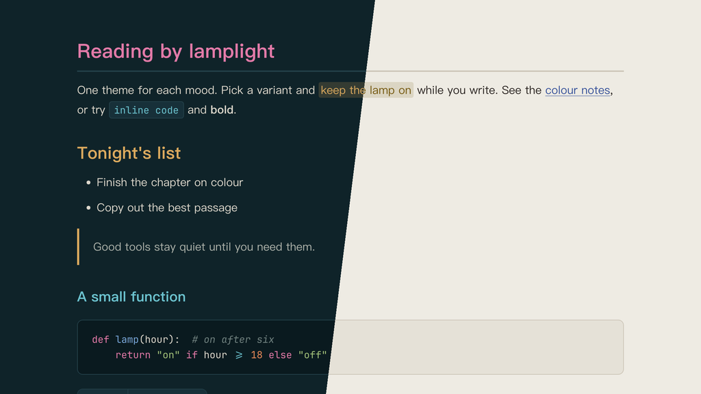

# Lamplit Shanghai（Typora 主题）

[English](README.md) · 简体中文

来自黄浦江两岸的上海。西岸是外滩夜里投光灯的暖金和装饰艺术风格的铜绿屋顶，东岸以陆家嘴玻璃幕墙的冷青和东方明珠的品红相应，梧桐绿和红瓦取自两岸之间的老弄堂。

提供两个变体，各是一个独立的 CSS 文件：外滩之夜，和武康路的午后。颜色与 Obsidian 主题 Lamplit 的 Shanghai 方案一致。

---

## 截图



---

## 变体

| 文件 | 模式 | 背景 | 文字 |
|------|------|------|------|
| `lamplit-shanghai-bund.css` | 深色 | `#0f2329` | `#ddd8cc` |
| `lamplit-shanghai-wukang.css` | 浅色 | `#eeebe3` | `#2c2623` |

## 颜色分工

| 角色 | Bund | Wukang | 用途 |
|------|------|--------|------|
| 外滩金 Gold | `#dcaa5e` | `#755910` | Bund 的强调色（H2、引用竖线、表头、任务复选框、侧边栏当前文件）；Wukang 里是 `==高亮==` 文字和 H5 |
| 梧桐绿 Plane | `#a3c27a` | `#4a6a26` | Wukang 的强调色（用途同 Bund 的外滩金）；Bund 里是字符串和 H5 |
| 明珠品红 Pearl | `#e27aa8` | `#a2366e` | Bund 的 H1、代码关键字 |
| 红瓦 Tile | `#e66a5f` | `#b03a36` | Wukang 的 H1、错误、删除行 |
| 玻璃青 Glass | `#6cc3cf` | `#186a80` | 行内代码、标签、Bund 的 H3 |
| 江水蓝 River | `#78a6d8` | `#37529a` | 链接、Wukang 的 H3 |
| 铜绿 Copper | `#62b89a` | `#2b6f55` | H4、嵌套引用 |
| 琥珀 Amber | `#e88a58` | `#a35a10` | 搜索命中、数字 |

所有点缀色对比度都在 4.3:1 以上，相近颜色之间的色差 ΔE ≥ 21。Wukang 的外滩金压深了一些，让高亮文字在金色淡底上仍然清楚。

---

## 特性

- **两岸**：江水底色上由暖金领衔，冷青在代码和标签里呼应，东方明珠的品红只出现一次，用作 H1
- **标题层级**：Bund 依次为品红 → 外滩金 → 玻璃青 → 铜绿 → 梧桐绿 → 注释色；Wukang 依次为红瓦 → 梧桐绿 → 江水蓝 → 铜绿 → 外滩金 → 注释色
- **中文优先的排版**：PingFang SC → Hiragino Sans GB → Noto Serif SC，行高舒适
- **代码块**：同时支持 highlight.js 和 CodeMirror 的语法高亮，颜色分工和 Obsidian 版一致
- **透明引用块**：Bund 用外滩金竖线，Wukang 用梧桐绿竖线，嵌套引用用铜绿
- **圆角网格表格**：强调色表头文字和下划线，行悬停淡色，没有斑马纹
- **元素覆盖完整**：任务列表、脚注、公式、Mermaid 图、YAML front matter、目录
- **打印 / PDF 导出**：优化了版式和分页

---

## 安装

### 一行命令（macOS、Linux）

不需要克隆仓库，重新运行即可更新。

```bash
curl -fsSL https://raw.githubusercontent.com/agiledolphin/themes/main/install.sh | bash -s -- typora shanghai
```

### 同步脚本

如果你已经克隆了仓库：

```bash
./scripts/sync-typora.sh shanghai
```

### 手动安装

1. 找到 Typora 的主题文件夹：
   - **macOS**：`~/Library/Application Support/abnerworks.Typora/themes/`
   - **Windows**：`%APPDATA%\Typora\themes\`
   - **Linux**：`~/.config/Typora/themes/`
2. 把需要的文件复制到这个文件夹：
   - `lamplit-shanghai-bund.css`
   - `lamplit-shanghai-wukang.css`
3. 打开 **Typora → 偏好设置 → 外观**，选择对应的主题

---

## 许可证

MIT
