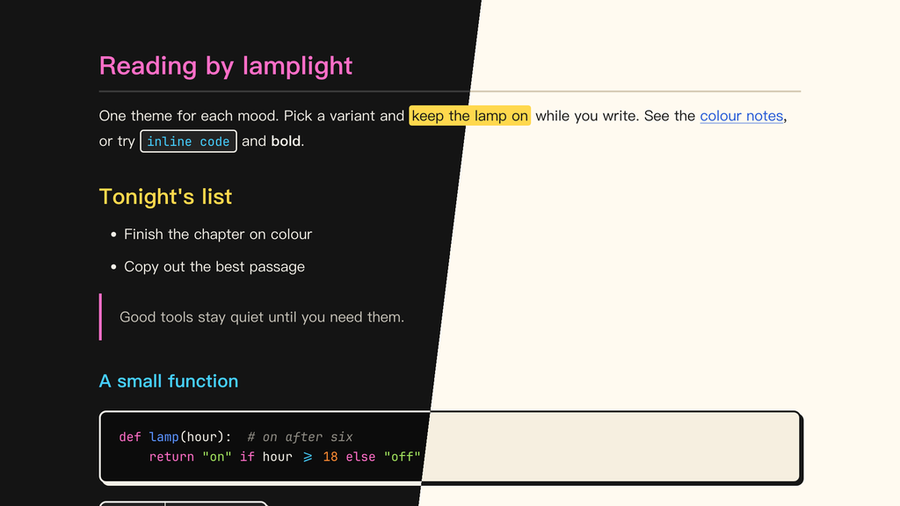

# Lamplit Tuttomondo for Typora

English · [简体中文](README.zh-CN.md)

A vivid Typora theme in the spirit of *Tuttomondo*, the 1989 mural in Pisa: flat bright colors inside heavy outlines. Code blocks, inline code and tables get a drawn frame and an unblurred offset shadow, `==highlighted==` text is a solid yellow block, and the color sits in blocks while the prose stays black on white (or chalk on black). The colors are our own, not sampled from the work.

Two variants are provided as separate CSS files: Subway, after chalk drawings on black subway ad panels, and Pisa, after the mural wall in daylight. Colors match the Tuttomondo scheme in the Obsidian theme Lamplit.

---

## Screenshots



---

## Variants

| File | Mode | Background | Text |
|------|------|------------|------|
| `lamplit-tuttomondo-subway.css` | Dark  | `#141414` | `#f3f0e8` |
| `lamplit-tuttomondo-pisa.css`   | Light | `#fffaf0` | `#171717` |

## Color roles

| Role | Subway | Pisa | Used for |
|------|--------|------|----------|
| Pink   | `#ff6ec7` | `#c0187a` | the accent: H1, blockquote rule, task checkboxes, active file in the sidebar, code keywords |
| Yellow | `#ffd84d` | `#ffd84d` | the solid `==highlight==` block; H2 in Subway |
| Blue   | `#5b93ff` | `#1f55d6` | links, table header; H2 in Pisa |
| Cyan   | `#46cfff` | `#00739a` | inline code; H3 in Subway |
| Green  | `#a2e35e` | `#2c7a12` | strings, nested quotes; H4 in Subway, H3 in Pisa |
| Orange | `#ff8c33` | `#b54800` | search hits, numbers; H5 in Subway, H4 in Pisa |
| Red    | `#ff5252` | `#c81e1e` | errors, deleted lines |
| Outline | `#f3f0e8` | `#171717` | frames and hard shadows |

Text colors read at 5.1:1 or better against their background, and look-alike colors stay at a color difference of ΔE ≥ 24. In Pisa the yellow block keeps its bright fill with dark text; as text, yellow darkens to an ochre.

---

## Features

- **Heavy outlines** — a 2px frame on code blocks and tables, 1.5px on inline code (chalk white in Subway, black in Pisa)
- **Hard shadows** — unblurred offset shadows under code blocks and tables
- **Color in blocks** — a solid `==highlight==` block, bright accents in headings, neutral prose
- **Heading hierarchy** — Subway: pink → yellow → cyan → green → orange → comment; Pisa: pink → blue → green → orange → teal → comment
- **Chinese-first typography** — PingFang SC → Hiragino Sans GB → Noto Serif SC, comfortable line height
- **Code blocks** — syntax highlighting via both highlight.js and CodeMirror classes, same color roles as the Obsidian version
- **Full element coverage** — task lists, footnotes, math, Mermaid diagrams, YAML front matter, TOC
- **Print / PDF export** — optimized layout with page-break hints

---

## Installation

### One command (macOS, Linux)

No clone needed. Run it again to update.

```bash
curl -fsSL https://raw.githubusercontent.com/agiledolphin/themes/main/install.sh | bash -s -- typora tuttomondo
```

### Automatic (sync script)

```bash
./scripts/sync-typora.sh tuttomondo
```

### Manual

1. Locate your Typora themes directory:
   - **macOS**: `~/Library/Application Support/abnerworks.Typora/themes/`
   - **Windows**: `%APPDATA%\Typora\themes\`
   - **Linux**: `~/.config/Typora/themes/`
2. Copy one or both CSS files into that directory
3. Open **Typora → Preferences → Appearance** and select the variant

---

## License

MIT
