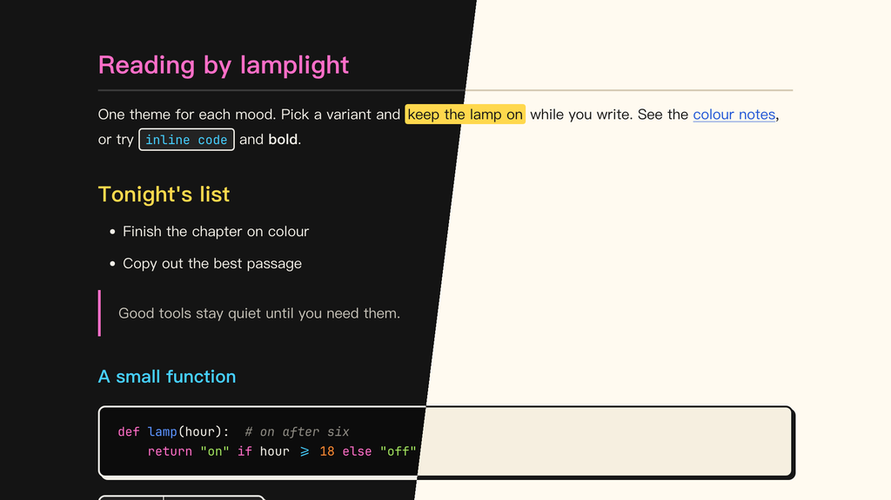

# Lamplit Tuttomondo（Typora 主题）

[English](README.md) · 简体中文

鲜艳风格的 Typora 主题，致敬 1989 年比萨的壁画 *Tuttomondo*（意为“整个世界”）：粗黑轮廓里填满平涂的亮色。代码块、行内代码和表格都有描边和不羽化的偏移阴影，`==高亮==` 是实心黄块；颜色集中在色块上，正文保持白底黑字（或黑底粉笔白）。配色是我们自己调的，不是从画作取色。

提供两个变体，各是一个独立的 CSS 文件：Subway 来自地铁站黑色广告板上的粉笔画，Pisa 来自日光下的壁画墙面。颜色与 Obsidian 主题 Lamplit 的 Tuttomondo 方案一致。

---

## 截图



---

## 变体

| 文件 | 模式 | 背景 | 文字 |
|------|------|------|------|
| `lamplit-tuttomondo-subway.css` | 深色 | `#141414` | `#f3f0e8` |
| `lamplit-tuttomondo-pisa.css` | 浅色 | `#fffaf0` | `#171717` |

## 颜色分工

| 角色 | Subway | Pisa | 用途 |
|------|--------|------|------|
| 粉 Pink | `#ff6ec7` | `#c0187a` | 强调色：H1、引用竖线、任务复选框、侧边栏当前文件、代码关键字 |
| 黄 Yellow | `#ffd84d` | `#ffd84d` | 实心 `==高亮==` 色块；Subway 的 H2 |
| 蓝 Blue | `#5b93ff` | `#1f55d6` | 链接、表头；Pisa 的 H2 |
| 青 Cyan | `#46cfff` | `#00739a` | 行内代码；Subway 的 H3 |
| 绿 Green | `#a2e35e` | `#2c7a12` | 字符串、嵌套引用；Subway 的 H4、Pisa 的 H3 |
| 橙 Orange | `#ff8c33` | `#b54800` | 搜索命中、数字；Subway 的 H5、Pisa 的 H4 |
| 红 Red | `#ff5252` | `#c81e1e` | 错误、删除行 |
| 描边 Outline | `#f3f0e8` | `#171717` | 描边和硬阴影 |

文字点缀色对比度都在 5.1:1 以上，相近颜色之间的色差 ΔE ≥ 24。Pisa 里的黄色作色块时保持明亮、配深色字，作文字时压成赭黄。

---

## 特性

- **粗描边**：代码块和表格 2px，行内代码 1.5px（Subway 粉笔白，Pisa 黑色）
- **硬阴影**：代码块和表格下方是不羽化的偏移阴影
- **颜色做色块**：实心 `==高亮==`，标题用亮色，正文保持中性
- **标题层级**：Subway 依次为粉 → 黄 → 青 → 绿 → 橙 → 注释色；Pisa 依次为粉 → 蓝 → 绿 → 橙 → 青绿 → 注释色
- **中文优先的排版**：PingFang SC → Hiragino Sans GB → Noto Serif SC，行高舒适
- **代码块**：同时支持 highlight.js 和 CodeMirror 的语法高亮，颜色分工和 Obsidian 版一致
- **元素覆盖完整**：任务列表、脚注、公式、Mermaid 图、YAML front matter、目录
- **打印 / PDF 导出**：优化了版式和分页

---

## 安装

### 一行命令（macOS、Linux）

不需要克隆仓库，重新运行即可更新。

```bash
curl -fsSL https://raw.githubusercontent.com/agiledolphin/themes/main/install.sh | bash -s -- typora tuttomondo
```

### 同步脚本

如果你已经克隆了仓库：

```bash
./scripts/sync-typora.sh tuttomondo
```

### 手动安装

1. 找到 Typora 的主题文件夹：
   - **macOS**：`~/Library/Application Support/abnerworks.Typora/themes/`
   - **Windows**：`%APPDATA%\Typora\themes\`
   - **Linux**：`~/.config/Typora/themes/`
2. 把需要的文件复制到这个文件夹：
   - `lamplit-tuttomondo-subway.css`
   - `lamplit-tuttomondo-pisa.css`
3. 打开 **Typora → 偏好设置 → 外观**，选择对应的主题

---

## 许可证

MIT
