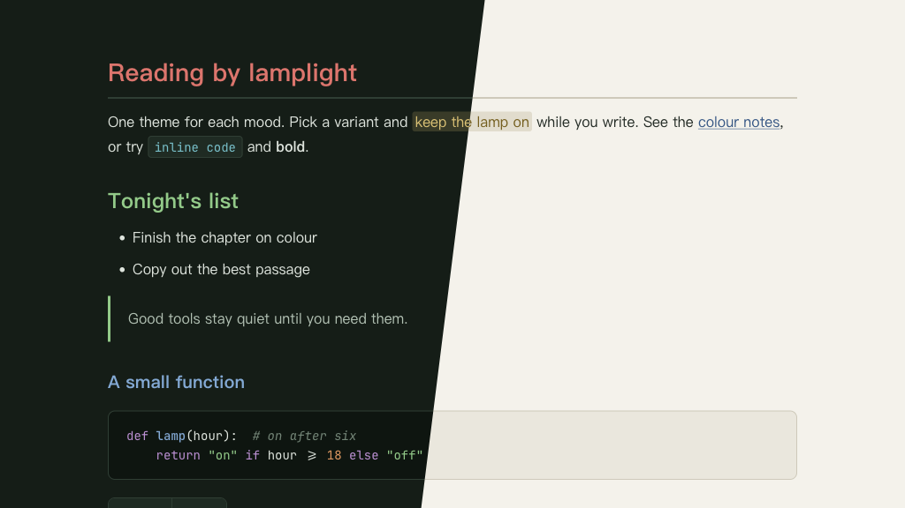

# Lamplit Walden for Typora

English · [简体中文](README.zh-CN.md)

A woodland Typora theme after Henry David Thoreau's *Walden* (1854): deep pine-needle green in dark mode, warm cotton-linen herbarium paper in light mode, fern green accents, and a touch of wild berry for H1.

Two variants are provided as separate CSS files. Colors match the Walden scheme in the Obsidian theme Lamplit.

---

## Screenshots



---

## Variants

| File | Mode | Background | Text |
|------|------|------------|------|
| `lamplit-walden-woods.css` | Dark  | `#131d17` | `#dce4dc` |
| `lamplit-walden-herbarium.css` | Light | `#f4f2ea` | `#222c25` |

## Color roles

| Role | Woods | Herbarium | Used for |
|------|-------|-----------|----------|
| Berry   | `#eb6e68` | `#b23430` | H1, errors, deleted lines |
| Fern    | `#82cc82` | `#2d6d32` | accent, H2, table header, blockquote rule, cursor, active file, strings |
| Pond    | `#78aad8` | `#2b5888` | links, H3, functions |
| Lichen  | `#5ec2cc` | `#156878` | H4, inline code, types |
| Moss    | `#4ebf9e` | `#186e58` | tags |
| Amber   | `#dfc068` | `#785d08` | `==highlighted==` text, H5 |
| Autumn  | `#e89254` | `#a24e10` | search hits, numbers |
| Heather | `#c48ed8` | `#724288` | code keywords, nested quotes |

Every accent reads at 4.5:1 or better against its background, and look-alike colors stay at a color difference of ΔE ≥ 21.

---

## Features

- **Woodland grounds** — deep pine forest green in dark mode, warm cotton-linen herbarium paper in light mode
- **Fern & berry** — fern green leads the accent, H2 and table headers; wild berry marks H1
- **Heading hierarchy** — H1–H6 in berry → fern → pond blue → lichen cyan → amber → comment
- **Chinese-first typography** — PingFang SC → Hiragino Sans GB → Noto Serif SC, comfortable line height
- **Code blocks** — syntax highlighting via both highlight.js and CodeMirror classes, same color roles as the Obsidian version
- **Transparent blockquotes** with a fern rule (heather for nested quotes)
- **Rounded grid tables** — fern header text and underline, row hover tint, no zebra striping
- **Full element coverage** — task lists, footnotes, math, Mermaid diagrams, YAML front matter, TOC
- **Print / PDF export** — optimized layout with page-break hints

---

## Installation

### One command (macOS, Linux)

No clone needed. Run it again to update.

```bash
curl -fsSL https://raw.githubusercontent.com/agiledolphin/themes/main/install.sh | bash -s -- typora walden
```

### Automatic (sync script)

```bash
./scripts/sync-typora.sh walden
```

### Manual

1. Locate your Typora themes directory:
   - **macOS**: `~/Library/Application Support/abnerworks.Typora/themes/`
   - **Windows**: `%APPDATA%\Typora\themes\`
   - **Linux**: `~/.config/Typora/themes/`
2. Copy one or both CSS files into that directory
3. Open **Typora → Preferences → Appearance** and select the variant

---

## License

MIT
