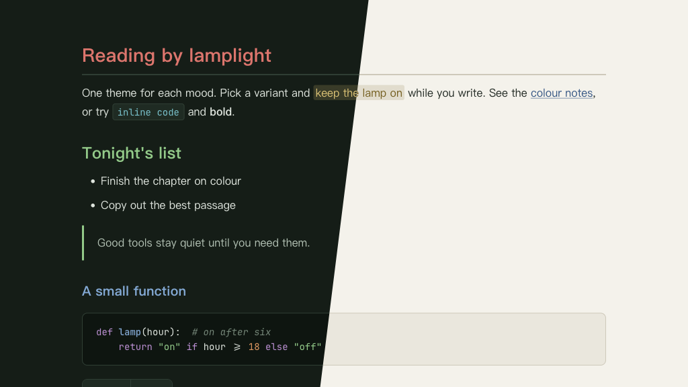

# Lamplit Walden（Typora 主题）

[English](README.md) · 简体中文

森林植物志风格的主题，致敬梭罗《瓦尔登湖》（1854）：深色模式是冷杉松针的深林墨绿，浅色模式是植物标本台纸的暖棉麻白，蕨叶绿作主强调色，一点浆果红作 H1。

提供两个变体，各是一个独立的 CSS 文件。颜色与 Obsidian 主题 Lamplit 的 Walden 方案一致。

---

## 截图



---

## 变体

| 文件 | 模式 | 背景 | 文字 |
|------|------|------|------|
| `lamplit-walden-woods.css` | 深色 | `#131d17` | `#dce4dc` |
| `lamplit-walden-herbarium.css` | 浅色 | `#f4f2ea` | `#222c25` |

## 颜色分工

| 角色 | Woods | Herbarium | 用途 |
|------|-------|-----------|------|
| 浆果红 Berry | `#eb6e68` | `#b23430` | H1、错误、删除行 |
| 蕨叶绿 Fern | `#82cc82` | `#2d6d32` | 强调色、H2、表头、引用竖线、光标、当前文件、字符串 |
| 湖水蓝 Pond | `#78aad8` | `#2b5888` | 链接、H3、函数 |
| 地衣青 Lichen | `#5ec2cc` | `#156878` | H4、行内代码、类型 |
| 苔藓绿 Moss | `#4ebf9e` | `#186e58` | 标签 |
| 松脂琥珀 Amber | `#dfc068` | `#785d08` | `==高亮==` 文字、H5 |
| 秋叶橙 Autumn | `#e89254` | `#a24e10` | 搜索命中、数字 |
| 石楠紫 Heather | `#c48ed8` | `#724288` | 代码关键字、嵌套引用 |

所有点缀色对比度都在 4.5:1 以上，相近颜色之间的色差 ΔE ≥ 21。

---

## 特性

- **林间与标本纸底色**：深色模式冷杉深林绿，浅色模式暖棉麻标本纸
- **万绿丛中一点红**：蕨叶绿领衔强调色、H2 与表头，浆果红作 H1
- **标题层级**：H1–H6 依次为浆果红 → 蕨叶绿 → 湖水蓝 → 地衣青 → 松脂琥珀 → 注释色
- **中文优先的排版**：PingFang SC → Hiragino Sans GB → Noto Serif SC，行高舒适
- **代码块**：同时支持 highlight.js 和 CodeMirror 的语法高亮，颜色分工和 Obsidian 版一致
- **透明引用块**：蕨叶绿竖线，嵌套引用用石楠紫
- **圆角网格表格**：蕨叶绿表头文字和下划线，行悬停淡色，没有斑马纹
- **元素覆盖完整**：任务列表、脚注、公式、Mermaid 图、YAML front matter、目录
- **打印 / PDF 导出**：优化了版式和分页

---

## 安装

### 一行命令（macOS、Linux）

不需要克隆仓库，重新运行即可更新。

```bash
curl -fsSL https://raw.githubusercontent.com/agiledolphin/themes/main/install.sh | bash -s -- typora walden
```

### 同步脚本

如果你已经克隆了仓库：

```bash
./scripts/sync-typora.sh walden
```

### 手动安装

1. 找到 Typora 的主题文件夹：
   - **macOS**：`~/Library/Application Support/abnerworks.Typora/themes/`
   - **Windows**：`%APPDATA%\Typora\themes\`
   - **Linux**：`~/.config/Typora/themes/`
2. 把需要的文件复制到这个文件夹：
   - `lamplit-walden-woods.css`
   - `lamplit-walden-herbarium.css`
3. 打开 **Typora → 偏好设置 → 外观**，选择对应的主题

---

## 许可证

MIT
