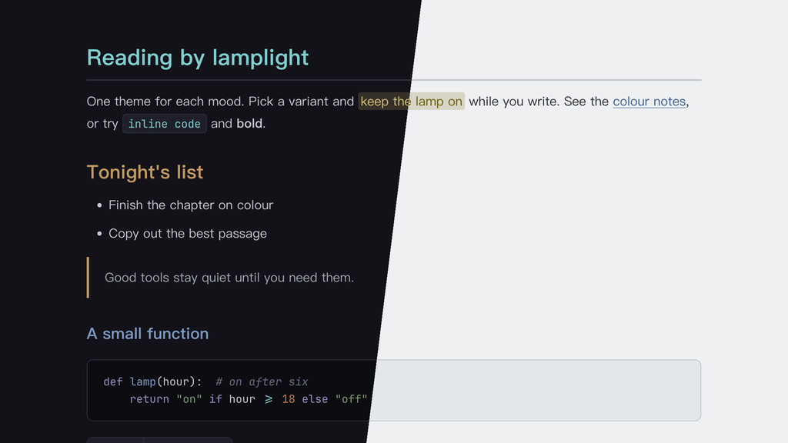

# Lamplit Wonderland（Typora 主题）

[English](README.md) · 简体中文

灵感来自村上春树《世界尽头与冷酷仙境》的「冷酷仙境」部分：冷峻、淡漠、略带超现实的东京，雨夜的街道、INKling 出没的地下水道、摆满头骨的实验室，只有台灯和威士忌酒吧的黄铜色是暖的。

提供三个变体，各是一个独立的 CSS 文件。颜色与 Obsidian 主题 Lamplit 的 Wonderland 方案一致。

---

## 截图



---

## 变体

| 文件 | 模式 | 背景 | 特点 |
|------|------|------|------|
| `lamplit-wonderland-underground.css` | 深色 | `#121218` | INKling 的地下水道：最深、最冷 |
| `lamplit-wonderland-office-district.css` | 深色 | `#1d1d1d` | 地面上的东京夜晚：略亮的中性炭灰 |
| `lamplit-wonderland-lab.css` | 浅色 | `#eef0f2` | 「组织」的无菌实验室：冷白 |

## 颜色分工

| 角色 | 用途 |
|------|------|
| 黄铜 Brass | 唯一的暖色点缀：H2、引用竖线、表头、任务复选框、侧边栏当前文件 |
| 冷青 Cyan | H1、行内代码 |
| 钢蓝 Steel | 链接、H3、目录链接 |
| 血红 Blood | 错误、删除行、代码里的 HTML 标签 |
| 苔绿 Moss | 字符串、H5 |

---

## 特性

- **克制的配色**：低饱和的靛黑底和冷灰白文字，黄铜是唯一的暖色点缀，不用霓虹色
- **标题层级**：H1–H6 依次为冷青 → 黄铜 → 钢蓝 → 青绿 → 苔绿 → 注释色
- **中文优先的排版**：PingFang SC → Hiragino Sans GB → Noto Serif SC，行高舒适
- **代码块**：同时支持 highlight.js 和 CodeMirror 的语法高亮，颜色分工和 Obsidian 版一致
- **透明引用块**：黄铜竖线，嵌套引用用钢蓝
- **圆角网格表格**：黄铜表头文字和下划线，行悬停为黄铜色，没有斑马纹
- **元素覆盖完整**：任务列表、脚注、公式、Mermaid 图、YAML front matter、目录
- **打印 / PDF 导出**：优化了版式和分页

---

## 安装

### 一行命令（macOS、Linux）

不需要克隆仓库，重新运行即可更新。

```bash
curl -fsSL https://raw.githubusercontent.com/agiledolphin/themes/main/install.sh | bash -s -- typora wonderland
```

### 同步脚本

如果你已经克隆了仓库：

```bash
./scripts/sync-typora.sh wonderland
```

### 手动安装

1. 找到 Typora 的主题文件夹：
   - **macOS**：`~/Library/Application Support/abnerworks.Typora/themes/`
   - **Windows**：`%APPDATA%\Typora\themes\`
   - **Linux**：`~/.config/Typora/themes/`
2. 把需要的文件复制到这个文件夹：
   - `lamplit-wonderland-underground.css`
   - `lamplit-wonderland-office-district.css`
   - `lamplit-wonderland-lab.css`
3. 打开 **Typora → 偏好设置 → 外观**，选择对应的主题

---

## 许可证

MIT
